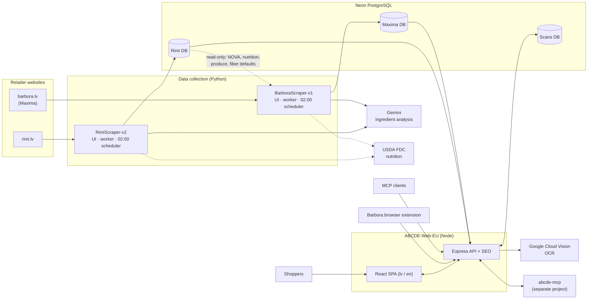
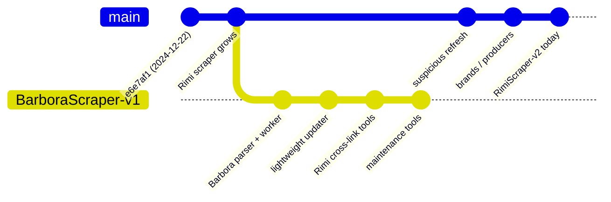
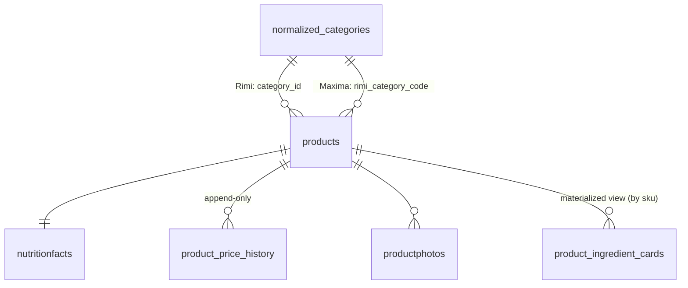
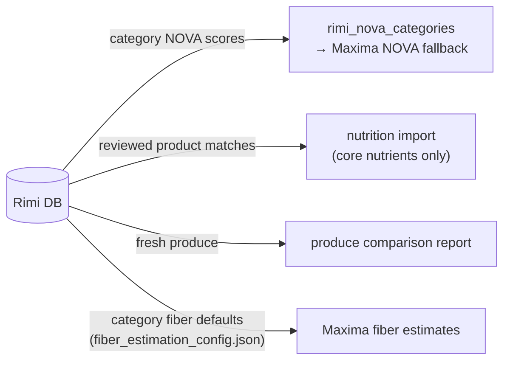
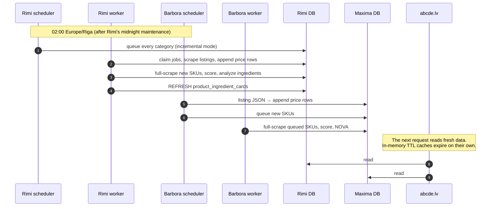

# ABCDE System Architecture

This document shows how the three repositories in this folder work together to run [abcde.lv](https://abcde.lv). Each repository has its own `ARCHITECTURE.md` with more detail:

| Repository | Role | Stack | Detail |
|---|---|---|---|
| [RimiScraper-v2](RimiScraper-v2/ARCHITECTURE.md) | Collects and scores Rimi products | Python, Streamlit, PostgreSQL, Gemini | Job-queue worker, Nutri-Score/NOVA formulas |
| [BarboraScraper-v1](BarboraScraper-v1/ARCHITECTURE.md) | Collects and scores Maxima products (Barbora.lv) | Python, Streamlit, PostgreSQL, Gemini | Fork of the Rimi scraper, linked to Rimi data |
| [ABCDE-Web-EU](ABCDE-Web-EU/ARCHITECTURE.md) | Public website and API | TypeScript, React, Express 5, Drizzle | Reads both scraper databases |

## System overview

Data moves in one direction: retailer website → scraper → PostgreSQL → website. The website never writes to the scraper databases. The scrapers never call the website.

## How the repositories relate

### 1. Shared code: the Barbora scraper is a fork

Both scraper repositories have the same root commit, `e6e7af1`. The fork kept most of the Rimi code: the job queue tables, `nutriscore_calculator.py`, `fiber_estimator.py`, the ingredient pipeline and the Streamlit layout. It then added Barbora-specific modules. Since the fork, each repository has changed on its own:

- **Rimi** added heartbeat leases for jobs, `suspicious_refresh` jobs and the nutrition validator.
- **Barbora** added the lightweight listing updater, stricter NOVA rules and the plan → preview → apply maintenance tools.

The two copies aren't kept in sync, so a fix in one doesn't automatically reach the other.

### 2. Shared data contract: same schema, two databases

Both scrapers write the same core tables. The website's Drizzle mappings in `ABCDE-Web-EU/lib/db/src/server/remote-schema.ts` depend on them:

| Contract | Rimi DB | Maxima DB | Website use |
|---|---|---|---|
| `normalized_categories` | **The category tree** | Barbora's own tree, not used by the site | All browsing and filtering |
| `products.category_id` | Rimi category | Barbora category | Rimi filtering |
| `products.rimi_category_code` | Text code, e.g. `SH-11-9-26` | **Integer = Rimi `category_id`** | Places Maxima products in Rimi's tree |
| `nutritionfacts.nutri_score_grade` | Calculated by the scraper | Calculated by the scraper | Grade badges, "healthier alternatives" |
| `product_price_history` | Append-only | Append-only | Latest row = current price (`LATERAL` join) |
| `product_ingredient_cards` | Materialized view | Materialized view | Ingredient breakdown on product pages |
| `products.is_hidden` | Set by the scraper UI | Set by the scraper UI | Not read directly. Hiding a product writes an `is_available = false` price row, and the site shows only available products. |

`rimi_category_code` means different things in the two databases: a text code in Rimi, a foreign key to a Rimi category in Maxima. Keep that in mind when changing either scraper's category logic.

### 3. Data from Rimi used by the Barbora scraper

The Barbora scraper uses data from the Rimi database through `RIMI_DATABASE_URL`, opened read-only:

So the Maxima data partly depends on the Rimi data. Changing a NOVA score on a Rimi category changes the NOVA fallback for Maxima products the next time `sync_rimi_nova_categories.py` runs.

## Daily cycle

## Scoring is done in the scrapers

The website shows `nutri_score_grade` and `nova_score` exactly as the scrapers store them. It doesn't recalculate them. The algorithms are implemented in Python, once in each scraper:

- **Nutri-Score 2024.** Each nutrient earns step-function points $\operatorname{pts}(x,T)=|\{i : x>t_i\}|$. The score is $S = N - P$, where $N$ counts energy, sugars, saturated fat and salt, and $P$ counts protein, fiber and fruit/vegetables/legumes. There are separate rules for beverages, cheese, red meat, and fats/oils/nuts. The derivation is in [RimiScraper-v2/ARCHITECTURE.md](RimiScraper-v2/ARCHITECTURE.md#nutri-score-2024-nutriscore_calculatorpy).
- **NOVA.** Any ingredient flagged *avoid* or *limit* gives group 4. Otherwise the product gets its category's group. Barbora adds checks so that missing or contradictory analysis leaves the score unknown instead of guessing; see [BarboraScraper-v1/ARCHITECTURE.md](BarboraScraper-v1/ARCHITECTURE.md#nova-rules).

The two NOVA implementations have drifted apart. The same product can get a different NOVA group depending on which store sells it.

## External services

| Service | Used by | Purpose | Config |
|---|---|---|---|
| Google Gemini 2.5 Flash | both scrapers | Ingredient classification, translation | `AI_INTEGRATIONS_GEMINI_*` |
| USDA FoodData Central | both scrapers | Missing nutrition | `USDA_API_KEY` |
| Google Translate | both scrapers | Product name translation | `GOOGLE_TRANSLATE_API_KEY` |
| Google Cloud Vision | website | OCR for photo scans | `GOOGLE_CLOUD_API_KEY` |
| abcde-mcp (Replit) | website | MCP server reached through the `/mcp` proxy | fixed upstream URL |
| Neon | all | PostgreSQL hosting | `*_DATABASE_URL` |
| Replit | all | Hosting (Autoscale UI; Reserved VM planned for workers) | `.replit` |

## Risks across the repositories

1. **Schema changes need coordination.** Changing a shared table in either scraper can break the website's Drizzle mappings without any error until a page fails. There is no shared schema package or contract test.
2. **The forked code drifts.** Fixes to shared modules such as Nutri-Score, fiber and ingredient processing must be applied twice.
3. **The website depends on Rimi's category tree.** Maxima products appear in the site only if they have a `rimi_category_code`. Any change to Rimi's tree affects both stores.
4. **Hiding depends on availability rows.** The site never reads `is_hidden`. A product stays off the site only while its latest price row says it's unavailable. Any code path that writes a new "available" row for a hidden product makes it visible again.
5. **The workers have no always-on host yet.** Both scrapers expect a Reserved VM. Until then the workers run on Autoscale with small chunks, so a large backlog can delay data on the site.
