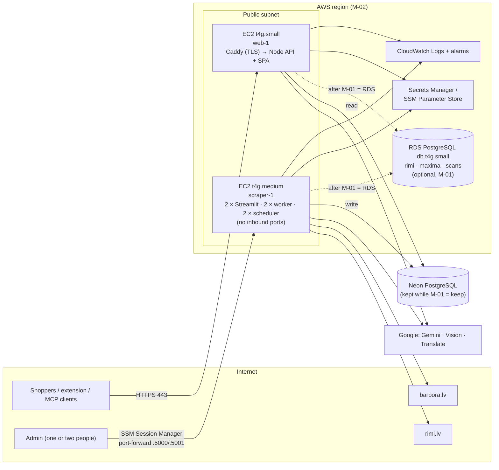

# AWS Migration Plan

> - **Status:** plan, 2026-11-11, for the customer to review. Nothing has been provisioned.
> - **Scope:** move `ABCDE-Web-EU`, `RimiScraper-v2` and `BarboraScraper-v1` from Replit to AWS. The databases can stay on Neon or move to Amazon RDS (decision M-01).
> - **Prices:** AWS public price list files for `eu-central-1` (Frankfurt) and `eu-north-1` (Stockholm), fetched 2026-11-11. They were published 2026-10-29 (RDS) and 2026-11-05 (VPC). All amounts are in USD and exclude VAT. Annual figures use 8,760 hours.
> - **Related:** `PROPOSAL_architecture_consolidation.md` Part B ("always-on worker host"). This plan provides that host. If the plan is accepted, decision D-05 of that proposal becomes "one EC2 instance for both workers" instead of "one Replit Reserved VM".

## 1. Summary

| | Recommendation |
|---|---|
| **Instances** | **2 × EC2**: `t4g.small` for the website, `t4g.medium` for both scrapers |
| **Database** | Keep Neon (M-01), but first check who owns each database (§3a). Any database created through Replit moves to the customer's own Neon account. Optionally move later, as a separate change, to **1 × RDS PostgreSQL `db.t4g.small`**, Single-AZ, holding all three databases. This needs a change to the website's database driver (§5.1). |
| **Region** | Same region as the Neon databases while Neon is kept, probably Frankfurt (M-02). Stockholm if everything moves to RDS. |
| **Cost per year** | **$661** (Frankfurt, keep Neon, on-demand) up to **$1,067** (Frankfurt, with RDS, on-demand). About **$453–744** with 1-year reserved instances. Full breakdown in §4. |

## 2. Target architecture

### Why two instances

- **The workloads are small.**
  - The scrapers make plain HTTP requests (`requests` + BeautifulSoup, no headless browser), and their speed is limited by deliberate crawl delays, not CPU.
  - The Replit plan for a worker was 0.5 vCPU and 2 GB (`BarboraScraper-v1/replit.md`), and a chunk of products uses about 58 MB of memory.
  - The Streamlit admin pages have only one or two users.
  - The site's catalogue is about 5,000+ products.
- **Keeping the scrapers away from the website.** A scraper running out of memory or a stuck worker can't take down the public site. The Streamlit admin pages have no login of their own, so they run on a server with **no open inbound ports**, reached only through AWS Systems Manager.
- **Why `t4g` (Graviton, burstable).** It's the cheapest current-generation option. Both Node 24 and Python 3.11 run on ARM64, and `sharp` and `psycopg2-binary` ship ARM64 builds. Burstable CPU fits a website that is mostly idle and scrapers that are busy at 02:00.
- **Why `t4g.medium` for the scrapers.** It runs two Streamlit apps (around 200–400 MB each), two workers with three threads each, and two schedulers. 4 GB leaves room. `t4g.small` (2 GB) would likely work but leaves little headroom while both nightly runs are active.

### What I'd leave out at this size

| Service | Why not now |
|---|---|
| Application Load Balancer | Adds a fixed hourly charge plus usage charges for one backend server. Caddy on the instance handles TLS with Let's Encrypt. Add one when the website runs on more than one server. |
| NAT Gateway | About $0.05/h plus data charges, which would be more than both instances together. The scraper server uses a public IP with no inbound rules instead. |
| ECS Fargate / EKS | More expensive than EC2 for services that run around the clock, and more to operate. Reconsider after Part E of the proposal, when there is a single scraper image. |
| Lambda | Doesn't fit long-running Streamlit apps and jobs that scrape whole categories. |
| Multi-AZ RDS | Doubles the database price (§4.3). The site is read-only on the store data and can tolerate a short outage. Revisit if it becomes business-critical. |

## 3. Region choice (M-02)

| Region | For | Against |
|---|---|---|
| **Frankfurt (`eu-central-1`)** | Neon offers this AWS region. Keeping the servers next to a Neon database there keeps query latency low and avoids cross-region transfer charges. | About 10–14 % more expensive than Stockholm (§4) |
| **Stockholm (`eu-north-1`)** | Closest AWS region to Latvia, and the cheapest of the two | Use it only if the databases move to RDS, or if Neon is in a nearby region |

**First step:** check which region the current Neon projects are in. The Neon console shows it, and it's also part of each connection string's hostname. Put the EC2 instances in the same AWS region.

## 3a. Who owns the databases (check first)

Replit's built-in PostgreSQL runs on Neon, but the Neon account and its billing belong to Replit, not the customer. The code suggests at least some of the three databases were created that way:

- `ABCDE-Web-EU/artifacts/api-server/src/db.ts` fails at start-up with "Please provision the local database" when `DATABASE_URL` is missing. That's Replit's wording for its built-in database.
- `BarboraScraper-v1/docs/rimi-nutrition-import.md:12` calls `RIMI_DATABASE_URL` "account-linked".

A database that Replit manages **has to move** when the Replit projects are shut down, whatever is decided for M-01. Before anything else, record for each database:

| Database | Environment variable(s) | Owner (Replit-managed / customer's Neon account) | Neon region | Size |
|---|---|---|---|---|
| Rimi | `DATABASE_URL` in RimiScraper-v2, `RIMI_DATABASE_URL` in the website and Barbora | to check | to check | to check |
| Maxima | `DATABASE_URL` / `PROD_DATABASE_URL` in BarboraScraper-v1, `MAXIMA_DATABASE_URL` in the website | to check | to check | to check |
| Scans | `DATABASE_URL` in ABCDE-Web-EU | to check | to check | to check |

How to check:
1. Open the Database tool in each Replit project. A database listed there is Replit-managed.
2. Log in to the customer's own Neon console and look for projects whose endpoint IDs match the hostnames in the connection strings.
3. Read the region from the hostname, e.g. `ep-…​.eu-central-1.aws.neon.tech`.

Moving a Replit-managed database to a Neon project the customer owns needs **no code changes**. Neon to Neon uses the same driver, so the only change is the connection string. The steps:
1. Stop the writers.
2. `pg_dump` from the old database and `pg_restore` into the new one.
3. Check the row counts.
4. Re-create the `product_ingredient_cards` materialized views.
5. Switch the connection strings.

This is step 1b in §6.

## 4. Costs

### 4.1 Unit prices (AWS price list, fetched 2026-11-11)

| Item | Unit | Frankfurt | Stockholm |
|---|---|---|---|
| EC2 `t4g.small`, Linux, on-demand | per hour | $0.0192 | $0.0172 |
| EC2 `t4g.small`, 1-yr standard RI, all upfront | per year | $99 | $89 |
| EC2 `t4g.medium`, Linux, on-demand | per hour | $0.0384 | $0.0344 |
| EC2 `t4g.medium`, 1-yr standard RI, all upfront | per year | $198 | $178 |
| EBS gp3 | per GB-month | $0.0952 | $0.0836 |
| EBS snapshot | per GB-month | $0.054 | $0.0475 |
| Public IPv4 address, in use | per hour | $0.005 | $0.005 |
| RDS PostgreSQL `db.t4g.micro`, Single-AZ, on-demand | per hour | $0.019 | $0.016 |
| RDS PostgreSQL `db.t4g.small`, Single-AZ, on-demand | per hour | $0.037 | $0.033 |
| RDS PostgreSQL `db.t4g.small`, Multi-AZ, on-demand | per hour | $0.074 | $0.065 |
| RDS PostgreSQL `db.t4g.small`, 1-yr RI, all upfront | per year | $209 | $188 |
| RDS gp3 storage | per GB-month | $0.137 | $0.120 |
| RDS backup storage beyond the free allowance | per GB-month | $0.103 | $0.090 |

### 4.2 Annual cost of the recommended setup

Assumptions:
- 30 GB gp3 disk per instance
- 2 public IPv4 addresses
- 50 GB RDS storage
- RDS backups within the free allowance, which equals the provisioned storage

| Line | Frankfurt on-demand | Frankfurt 1-yr RI | Stockholm on-demand | Stockholm 1-yr RI |
|---|---:|---:|---:|---:|
| EC2 web `t4g.small` | $168.19 | $99.00 | $150.67 | $89.00 |
| EC2 scrapers `t4g.medium` | $336.38 | $198.00 | $301.34 | $178.00 |
| EBS gp3, 2 × 30 GB | $68.54 | $68.54 | $60.19 | $60.19 |
| Public IPv4 × 2 | $87.60 | $87.60 | $87.60 | $87.60 |
| **Subtotal: compute (keep Neon)** | **$660.71** | **$453.14** | **$599.80** | **$414.79** |
| RDS `db.t4g.small` Single-AZ | $324.12 | $209.00 | $289.08 | $188.00 |
| RDS gp3, 50 GB | $82.20 | $82.20 | $72.00 | $72.00 |
| **Total with RDS** | **$1,067.03** | **$744.34** | **$960.88** | **$674.79** |

Small extras not in the table:
- **EBS snapshots:** about $10–20/year for weekly snapshots.
- **CloudWatch Logs:** a few dollars per year at this volume.
- **Internet data transfer out:** AWS's free allowance (100 GB/month) should cover a site of this size. Check it against actual traffic, especially from `/api/image-proxy`.

### 4.3 Other options, per year (on-demand)

| Option | Frankfurt | Stockholm | Note |
|---|---:|---:|---|
| One `t4g.medium` for everything, 1 disk, 1 IP (no RDS) | $414.46 | $375.24 | Saves about $225–245/year but loses the separation between website and scrapers |
| Scrapers on `t4g.small` instead of `t4g.medium` | −$168.19 | −$150.67 | Possible. Watch memory during the 02:00 runs first. |
| RDS `db.t4g.micro` (1 GB) instead of `small` | −$157.68 | −$148.92 | Tight for three databases plus the scrapers' concurrent writes |
| RDS Multi-AZ instead of Single-AZ | +$324.12 | +$280.32 | Only if a database outage of a few minutes is unacceptable |

### 4.4 Costs outside AWS (not included above)

| Service | Used by | Note |
|---|---|---|
| Neon PostgreSQL | all, while M-01 = keep | The current Neon bill continues. It goes away if the databases move to RDS. |
| Google Gemini 2.5 Flash | both scrapers | Probably provided through Replit until now (`AI_INTEGRATIONS_GEMINI_*`). After the move it needs a **Google AI Studio or Vertex AI key and its own billing.** |
| Google Cloud Vision | website photo scans | Already a direct Google key (`GOOGLE_CLOUD_API_KEY`) |
| Google Translate | both scrapers | Already a direct key (`GOOGLE_TRANSLATE_API_KEY`) |
| USDA FoodData Central | both scrapers | Free key |
| abcde-mcp | website `/mcp` proxy | A separate Replit project (`abcde-mcp.replit.app`). Migrate it as well, or leave it on Replit (M-04). |
| Domain and DNS | website | Move DNS to Route 53 ($0.50/month per hosted zone) or keep the current DNS provider. |

## 5. Changes needed in the code

Changes needed to run outside Replit:

| Repository | Change | Where |
|---|---|---|
| all | Replace `.replit` and `replit.nix` with a `Dockerfile` (or systemd units) and a `docker-compose.yml` per server | repo root |
| all | Load secrets from SSM Parameter Store or Secrets Manager into environment variables at start-up, instead of Replit Secrets | deploy scripts |
| both scrapers | Gemini: replace `AI_INTEGRATIONS_GEMINI_API_KEY` and `AI_INTEGRATIONS_GEMINI_BASE_URL` with a direct key. With no base URL set, `genai.Client` uses Google's default endpoint. | Rimi: `combined_ingredient_analyzer.py`, `ingredient_ai_categorizer.py`, `suspicion_analyzer.py`. Barbora: `combined_ingredient_analyzer.py`, `food_translator.py`. 14 references in total. |
| both scrapers | The `ENVIRONMENT`/`DEV_MODE` and `PROD_DATABASE_URL` conventions stay. Set them explicitly in each server's environment. | `database_config.py` |
| RimiScraper-v2 | `combined_startup.sh` runs Streamlit and `worker_with_scheduler.py`. Keep it as the container entrypoint, or split it into two systemd services. | `combined_startup.sh` |
| BarboraScraper-v1 | Add `barbora_worker.py` as its own long-running service. The current startup script runs only the UI and the scheduler. Run it in a loop, because it has no daemon mode (it has `--exit-when-empty`). | new service unit |
| ABCDE-Web-EU | Remove the `replit.dev` origin from the scan CORS check | `artifacts/api-server/src/routes/routes.ts:1019` |
| ABCDE-Web-EU | The `REPLIT_DEV_DOMAIN` branches are only for development. Leave them unset in production, or remove them. | `app.ts`, `mcpMachineProxy.ts`, `mcpPageProxy.ts` |
| ABCDE-Web-EU | Remove the unused `@replit/object-storage` dependency | `artifacts/api-server/package.json` |
| ABCDE-Web-EU | Set `SCAN_TOKEN_SECRET` explicitly. Without it, a random secret is created at every restart. | environment |
| ABCDE-Web-EU | Serve the built SPA and API from one Node process behind Caddy. `pnpm run build`, then `node dist/index.mjs`. | deploy script |

### 5.1 Only if the databases move to RDS (M-01 = RDS)

The scrapers use `psycopg2`, which works with any PostgreSQL, so they need only new connection strings. The website is tied to Neon's own drivers, which don't work against RDS:

| Change | Where | Note |
|---|---|---|
| Replace `Pool`/`neonConfig` from `@neondatabase/serverless` and `drizzle-orm/neon-serverless` with `pg`'s `Pool` and `drizzle-orm/node-postgres`. Remove the WebSocket setup (`neonConfig.webSocketConstructor`, `poolQueryViaFetch`). | `artifacts/api-server/src/db.ts` (78 lines) | Keep the pool limits (`max: 5`, idle and lifetime timeouts). Turn on TLS to RDS with the AWS root CA bundle. |
| Replace Neon's HTTP `neon(url)` client with a `pg` pool or client | `artifacts/api-server/src/lib/barboraDatabase.ts` | Used by the `/api/extension` lookup |
| **Check every place that depends on the shape of a query result** | `artifacts/api-server/src/routes/routes.ts`: 17 checks of the form `Array.isArray(...Result)` | Drivers can return results in a different shape (an array of rows, or an object with `.rows`). If the shape changes, these checks fail **without an error**, and endpoints quietly return empty data, for example "no healthier products". Change them to use one helper, and test each endpoint against RDS before the switch. |
| Remove `@neondatabase/serverless` and `ws` from the dependencies, and add `pg` and `@types/pg` | `artifacts/api-server/package.json`; `replit.md` "Gotchas" | |
| Make sure the `pg_trgm` extension exists on RDS, and re-create the materialized views and their unique indexes | `RimiScraper-v2/schema.sql` (`gin_trgm_ops`, `product_ingredient_cards`) | `pg_restore` restores the views. Refresh them once after restoring. |

Estimated effort: 2–3 days including the endpoint tests, separate from the server migration.

## 6. Migration steps

```mermaid
gantt
    title Migration timeline (working days, estimates)
    dateFormat  X
    axisFormat  %s
    section Prepare
    Find database owners and Neon regions, AWS account, IAM, budget alerts :p1, 0, 1
    Move Replit-managed databases to the customer's own Neon project (if any) :p1b, 1, 2
    Dockerfiles / service units, secrets list         :p2, 1, 3
    Own Gemini API key, test scrapers locally         :p3, 2, 3
    section Build
    Provision VPC, 2 EC2, security groups, SSM        :b1, 3, 4
    Deploy website to web-1, test on temporary hostname   :b2, 4, 5
    Deploy scrapers to scraper-1 with workers stopped        :b3, 4, 5
    section Cutover
    Stop Replit workers + schedulers; start AWS ones  :c1, 5, 6
    Lower DNS TTL, switch abcde.lv to web-1           :c2, 6, 7
    Watch 2 nightly runs                              :c3, 7, 9
    section Finish
    Shut down Replit deployments                      :f1, 9, 10
    section Later, separately (M-01 = RDS)
    Website driver change + endpoint tests (§5.1)     :o0, 12, 15
    Create RDS, pg_dump/pg_restore from Neon, switch connection strings      :o1, 15, 17
```

1. **Prepare.**
   - Fill in the database ownership table in §3a: owner, Neon region and size of each database. The region decides M-02.
   - Create the AWS account structure, with an IAM user or SSO for the admin and a **budget alert** at, for example, $120/month.
   - Get a Gemini API key.
   - Write Dockerfiles or systemd units.
   - List every secret currently set in the three Replit projects.
1b. **Move any Replit-managed database to a Neon project the customer owns.** Do this only for databases §3a marks as Replit-managed. Create the new project in the region chosen for M-02, then follow the steps in §3a. Writes must be stopped during the copy, so do it in a quiet window outside 02:00. No code changes are needed. After this step the customer owns every database, and nothing that remains depends on Replit.
2. **Build.**
   - Create one VPC with a public subnet, and two EC2 instances using Amazon Linux 2023 ARM64 and an IAM role allowing SSM and CloudWatch.
   - Security groups: **web-1** accepts 80/443 from anywhere. **scraper-1** accepts no inbound traffic.
   - Give web-1 an Elastic IP. Use Caddy for HTTPS.
3. **Test the website in parallel.** Deploy it to web-1 using the **same Neon connection strings** in read-only use, so both deployments serve the same data. Test it on a temporary hostname: SEO pages, scan, extension endpoint and MCP proxy.
4. **Hand over the scrapers.**
   - Deploy them to scraper-1 with workers and schedulers **stopped**.
   - Stop the workers and schedulers on Replit, then start them on AWS. **Never run both at once.** Two schedulers would queue duplicate jobs, and the Barbora worker doesn't reclaim stale jobs (`THINGS_TO_LOOK_AT.md` §4).
5. **Switch DNS.**
   - Lower the TTL of `abcde.lv`, `www.abcde.lv`, `nutri-score.lv` and `nutriscore.lv` a day ahead.
   - Point them at web-1's Elastic IP.
   - Keep the Replit website running until DNS has propagated.
6. **Watch two nightly runs.** Compare `daily_update_logs` and `lightweight_update_runs` with the previous Replit runs: the number of categories, price changes and errors.
7. **Optional, later, as a separate change: move the databases to RDS** (M-01). Don't do this during the server cutover. Do it only after the website's driver change (§5.1) has passed its endpoint tests against a test RDS instance.
   - Create the RDS instance with three databases.
   - Copy the data with `pg_dump`/`pg_restore` from Neon during a short write freeze, with the workers stopped.
   - Re-create the `product_ingredient_cards` materialized views, and check that the `pg_trgm` extension exists (`schema.sql` uses `gin_trgm_ops`).
   - Switch the connection strings.
8. **Shut down Replit**, after a week without problems.

### Rollback

Until step 8 the Replit deployments stay available:

- **Website:** point DNS back to Replit.
- **Scrapers:** stop the AWS services and start the Replit ones again.
- **Databases:** while Neon is kept, there is nothing to roll back. After a move to RDS, keep Neon read-only for a week so you can switch back.

## 7. Operations on AWS

| Concern | Setup |
|---|---|
| Process supervision | systemd (`Restart=always`) or Docker Compose (`restart: unless-stopped`). This replaces Replit's supervision and `combined_startup.sh`'s restart loop. |
| Logs | CloudWatch agent sending the systemd/container logs, retained for 30 days |
| Alarms | EC2 status check failed. CPU credit balance low on scraper-1. A daily check that `daily_update_logs` has a row for today. |
| Backups | Weekly EBS snapshots through Data Lifecycle Manager. RDS automated backups (7 days) if M-01 = RDS. Neon's own history while M-01 = keep. |
| Patching | `dnf upgrade` monthly through SSM Patch Manager, or rebuild containers from updated base images |
| Admin access | SSM Session Manager only: no SSH keys and no open port 22. Streamlit through `aws ssm start-session --document-name AWS-StartPortForwardingSession`. |
| Cost control | AWS Budgets alert. Buy 1-year RIs or a Compute Savings Plan after a month of stable use. |

## 8. Risks

| Risk | Mitigation |
|---|---|
| Rimi or Barbora rate-limit or block requests from AWS IP ranges, which they may treat differently from Replit's | Test a full category scrape from scraper-1 before cutover (step 4). Keep the existing delays. Contact the retailers if blocked. |
| CPU credits run out on `t4g` during long nightly runs | `t4g` runs in Unlimited mode by default, so the risk is a small extra charge, not slowdown. Alarm on credit balance. Move to `m7g.medium` if usage is high all the time. |
| Gemini behaves differently with a direct key (quotas, model access) | Re-run a sample of ingredient analyses before cutover (step 1) |
| Duplicate jobs while Replit and AWS workers overlap | Strict order in step 4. Never run both. |
| A secret is left behind on Replit | List the secrets in step 1 and check them off. Rotate the database passwords after cutover. |
| A database turns out to be Replit-managed and is lost when the Replit projects are shut down | §3a ownership check in step 1, and the move in step 1b. Don't shut down Replit (step 8) until every database in §3a is marked as owned by the customer. |
| After a move to RDS, endpoints quietly return empty data because query results come back in a different shape | §5.1: one helper for result handling, and endpoint tests against RDS before switching |

## 9. Decisions for the customer

| ID | Decision |
|---|---|
| **M-01** | **Keep Neon** and move the servers only. Any Replit-managed database moves to the customer's own Neon account (step 1b) (recommended: no code changes, smallest change, easy rollback; Neon keeps handling backups and point-in-time restore). The alternative is to **move to RDS**: one vendor and private networking, but about $406/year more on AWS (Frankfurt, on-demand) and a rewrite of the website's database driver (§5.1). If chosen, do it later as its own change (step 7), never during the cutover. Compare the actual Neon invoices with the RDS cost before deciding. |
| **M-02** | **Same region as Neon**, probably Frankfurt (recommended: low latency, no cross-region transfer). The alternative is Stockholm, cheaper and closer to Latvia, but only sensible once the databases are on RDS. |
| **M-03** | **Two instances** (recommended: the public site is separated from the scrapers, and admin pages aren't exposed). The alternative is **one `t4g.medium`** (about $225–245/year cheaper, but a single point of failure). |
| **M-04** | **Leave `abcde-mcp` on Replit** for now (recommended: it's a separate service behind a fixed URL, and the website only proxies to it). The alternative is to migrate it too, as a third small service on web-1. |
| **M-05** | **On-demand for the first month, then 1-year reserved instances or a Savings Plan** (recommended: confirm the sizing before committing, then save about 30–40 %). The alternative is to commit on day one. |
