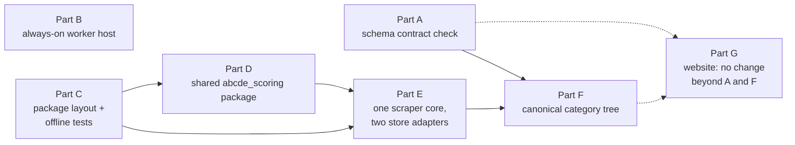

# Proposal — Consolidate the ABCDE scrapers and make the shared data contract explicit

> - **Status:** proposal, 2026-11-11. This proposal has **no `SPEC.md` version**: none of the three repositories has a `SPEC.md`. It is an architecture change plan covering `RimiScraper-v2`, `BarboraScraper-v1` and `ABCDE-Web-EU`. The draft rows in §2 are numbered from 01 for a future system-level `SPEC.md`, which `spec-writing` would create once the requester settles D-01 to D-06. No other `PROPOSAL_*.md` exists in this folder or the three repositories, so there are no numbering conflicts.
> - **Applies to:**
>   - `RimiScraper-v2` @ `6741db0`
>   - `BarboraScraper-v1` @ `d819fef`
>   - `ABCDE-Web-EU` @ `1a0c1de`
>   - the top-level `ARCHITECTURE.md` and `THINGS_TO_LOOK_AT.md` @ `ca0d3c2`
>
>   It replaces the separate fixes in `THINGS_TO_LOOK_AT.md` §2, §3, §4, §6 and §7 with structural changes. It doesn't cover §1 (the Nutri-Score cut-off check), which can be fixed on its own. After Part D, the fix is needed in only one place.
> - **Notation:** ids without a prefix (R-, C-, K-, T-, D-) belong to this proposal. Code references are written as `repo/path:line`, relative to this folder.
> - **Evidence:** all figures were measured on 2026-11-11 with `diff`, `cmp`, `ls`, `grep` and `wc` on the commits above.
>   - **Python files with the same name in both scrapers:** 70. Of these, 43 are byte-identical and 27 differ.
>   - **Python files in only one scraper:** 28 only in Rimi, 54 only in Barbora.
>   - **Changed lines per file** (`diff | grep -c '^[<>]'`):

| File | Changed lines | Rimi lines | Barbora lines |
|---|---|---|---|
| `nutriscore_calculator.py` | 505 | 629 | 774 |
| `fiber_estimator.py` | 889 | 468 | 479 |
| `nova_calculator.py` | 224 | 131 | 123 |
| `combined_ingredient_analyzer.py` | 222 | 533 | 485 |
| `worker.py` | 470 | 1010 | 554 |

>   - **Files at the top level:** 132 in Rimi (98 `.py`) and 155 in Barbora (124 `.py`).
>   - **Test files:** Rimi has 27 `test_*.py`, of which 7 reference `DATABASE_URL` or `psycopg2.connect`. Barbora has 31, of which 14 do.
>   - **One-off scripts:** 14 `debug_*`/`fix_*` scripts in each scraper.
>   - **Largest files:** `main.py` has 3354 lines (Rimi) and 2914 (Barbora). `routes.ts` has 2594 lines.

## 1. The problem

The system is three repositories that share one data contract and keep it in sync only by convention.

**The Barbora scraper is a fork, and the copies have drifted.** Both scraper repositories have the same root commit, `e6e7af1`. Of the 70 Python files present in both, 27 now differ. The differences that matter are in the scoring and job code, not in the scraping code that really should differ by store.

Reading the differing files in full narrows the problem in one important way.

- **The Nutri-Score formula has not drifted.** `calculate_nutriscore_2024` is identical in both repositories except for one blank line. I extracted the function from each repo and compared it with `diff`.
- **Most of the 505 changed lines decide which scoring category a product falls into:**
  - **Rimi** reads `normalized_categories.nutriscore_category_type`, a database column that can be edited in the Streamlit UI (`RimiScraper-v2/nutriscore_calculator.py:46–55`, `:283`).
  - **Barbora** resolves hard-coded sets of category UUIDs (`FATS_OILS_NUTS_UUIDS`, `CHEESE_UUIDS` and others) to IDs when it starts (`BarboraScraper-v1/nutriscore_calculator.py:368–415`, `:470–503`).

  So the same product can get a different grade at the two stores because of category mapping, not arithmetic. In Barbora, the mapping can only be changed by editing code.
- **NOVA has drifted in its rules** (`THINGS_TO_LOOK_AT.md` §2):
  - **Rimi** has two passes: an additive override, otherwise the category's group.
  - **Barbora** adds a flavouring marker and a "pending analysis" result, and refuses to give group 1 to products with added salt or flavouring.

  Barbora's version is the more careful one, but only Maxima products benefit from it.
- **Fiber estimation was rewritten in Barbora** (889 changed lines). Rimi looks up a Python dictionary by Rimi category code. Barbora reads `fiber_estimation_config.json` by `rimi_category_code`. The values come from the same source, but the code to apply them was written twice.
- **The job queue drifted in a way that loses work** (`THINGS_TO_LOOK_AT.md` §4). Rimi's `worker.py` holds heartbeat leases and reclaims stale jobs (`RimiScraper-v2/worker.py:260–315`). Barbora's `barbora_worker.py:106–131` sets `status = 'processing'` and never reclaims a job. A Barbora worker killed by Autoscale's 90-second limit leaves its job stuck forever.

**The database contract is implicit.** The website keeps hand-written Drizzle copies of the scraper tables in `ABCDE-Web-EU/lib/db/src/server/remote-schema.ts`. Nothing compares them with `RimiScraper-v2/schema.sql` or `BarboraScraper-v1/barbora_schema.sql`. One column already has a different meaning in each database:

- `remote-schema.ts:17` maps Rimi's `rimi_category_code` as `varchar` (for example `SH-11-9-26`).
- `remote-schema.ts:53` maps Maxima's `rimi_category_code` as an `integer` that holds a Rimi `category_id`.

`ABCDE-Web-EU/artifacts/api-server/src/storage.ts` refers to it 9 times to place Maxima products in Rimi's category tree.

**Category structure depends on one retailer.** Rimi's `normalized_categories` is the only tree the site uses. Maxima products are linked to it by a number pointing into another store's database. If Rimi's category IDs are ever re-imported, Maxima products move to the wrong categories or disappear, and no error is raised.

**Workers have no suitable host.** Both scrapers' `replit.md` describe a Reserved VM that isn't available, and the workers run on Autoscale with `--chunk-size 3 --max-workers 1`. `BarboraScraper-v1/combined_startup.sh` doesn't start the worker at all, so SKUs queued overnight wait until someone starts it by hand.

**The repositories are hard to change safely.**

- More than 130 files sit at the top level of each scraper, including 14 one-off `debug_*`/`fix_*` scripts in each, and `main.py` files of nearly 3,000 lines or more.
- About a quarter to a half of the test files (7 of 27 in Rimi, 14 of 31 in Barbora) open a real database connection. Running the test suite safely therefore depends on which `DATABASE_URL` is set.

**One claim was checked and withdrawn.** An earlier version of `ARCHITECTURE.md` said hidden products still appear on the site because the API never reads `is_hidden`. Reading `RimiScraper-v2/product_view_db.py:832–860` and `BarboraScraper-v1/barbora_lightweight_updater.py:154`, `:303` shows otherwise. Hiding a product writes an `is_available = false` price row, and the site shows only available products (`storage.ts:382–386`). What remains is the narrower gap in `THINGS_TO_LOOK_AT.md` §5. This proposal takes no position on `is_hidden` beyond R-05.

**The website isn't the problem.** It's a well-organized pnpm monorepo, and the security work on its scan, extension and MCP endpoints is careful. Its debts are a 2594-line `routes.ts` and a mix of generated and hand-written API clients. These are real but not urgent, and this proposal leaves them alone except where Parts A and F require changes.

## 2. The change

There are six parts. The cheap, independent ones come first, so any of them can be accepted without the others.

*The figure shows Parts A to G and their order. An arrow means "should be done before". Parts A and B don't depend on anything else.*

### Part A: make the shared schema an explicit, checked contract

1. Write down the website's view of the scraper tables as a contract: the tables and columns in `remote-schema.ts`, with their types.
2. Add a check that compares the contract with `information_schema.columns` in each live database. Run it in the website's CI, and as a startup self-test that logs a clear error.
3. Add the same contract file to both scrapers. Their migrations must fail if they would break it.

This needs no data migration. It also documents the `rimi_category_code` type difference instead of leaving it to be discovered.

### Part B: give the workers an always-on host

1. Run the scrapers' workers on one Reserved VM (D-05) under a supervisor. `RimiScraper-v2/combined_startup.sh` already supervises with backoff.
2. Port Rimi's heartbeat lease (`worker.py:260–315`) to the Barbora worker so stale jobs are reclaimed.
3. Start the Barbora worker automatically.

This fixes the stuck-job problem and the "nobody started the worker" problem now. Part E removes the duplicate worker code later.

### Part C: restructure each scraper into packages and run tests without a database

1. Move the code into packages: `scrape/`, `persist/`, `scoring/`, `jobs/`, `ui/`, `tools/`, `tests/`.
2. Move the one-off `debug_*` and `fix_*` scripts to `archive/`.
3. Split `main.py` into one module per Streamlit section. The functions already exist, for example `section_product_view` and `section_worker_health`.
4. Mark tests that need a database with `@pytest.mark.db`, and skip them unless `ABCDE_TEST_DATABASE_URL` is set. Never fall back to `DATABASE_URL`.

### Part D: extract one `abcde_scoring` package

1. Create one Python package containing:
   - `calculate_nutriscore_2024`, already identical in both repositories
   - NOVA, using Barbora's stricter rules by default (D-03)
   - fiber estimation
   - the nutrition validator
   - the ingredient analysis prompt and its parsing
2. Store-specific input comes in as data, never code. This includes each category's Nutri-Score type (D-02), its default NOVA group and its default fiber value.
3. Both scrapers import the package at a pinned version.

### Part E: one scraper core with a Rimi adapter and a Barbora adapter

1. Merge the scrapers into one repository, `abcde-scraper` (D-01).
2. The shared core holds the job queue (Rimi's lease design), persistence, enrichment and the Streamlit UI.
3. Each store adapter implements a small interface (C-02): list categories, list products in a category with listing prices, and fetch product details.
4. Each store keeps its own database (D-06), and the core writes to whichever database belongs to the job's store.

Barbora's careful plan/preview/apply maintenance tools move into the core as tools that work for either store.

### Part F: a store-neutral category tree

1. Add a `canonical_categories` tree with frozen IDs, plus a `store_category_map (store, store_category_id, canonical_category_id)` table (D-04).
2. Each store's products map to the canonical tree through the map.
3. Replace Maxima's integer `rimi_category_code` with a canonical category ID.
4. The website reads categories from the canonical tree and filters both stores by canonical ID.
5. Rimi's current tree becomes the first version of the canonical tree, so nothing changes on the site on day one.

### Part G: website

The website changes in only two ways:

- it adopts the contract check (Part A);
- it switches category queries to canonical IDs (Part F).

Splitting `routes.ts` and generating the old endpoints from OpenAPI are explicitly out of scope (§6).

Proposed rows for a future system `SPEC.md`, drafted for `spec-writing`:

| Family | Draft |
| -- | -------- |
| **R-01** | Every table and column the website reads from a scraper database MUST be listed, with its SQL type, in one contract file versioned with the website. On every CI run and at startup, the website MUST compare that file against `information_schema.columns` in each configured store database. If a listed column is missing or has a different type, startup MUST log an error naming the database, table and column. Source: §1 (`remote-schema.ts:17` vs `:53`). |
| **R-02** | A scraper migration MUST NOT remove, rename or change the type of a column listed in the contract file unless the same change updates the contract file. A scraper's migration test MUST fail when a migration would break the contract. Source: §1. |
| **R-03** | Every job worker MUST hold a lease on the job it is processing and renew it at least every `heartbeat_interval` seconds. A job whose lease is older than $2 \times$ `heartbeat_interval` MUST be claimable by another worker, which MUST increase `retry_count`. A worker that has lost its lease MUST NOT record progress on that job. Source: §1 (`barbora_worker.py:106–131` vs `worker.py:260–315`). |
| **R-04** | The Nutri-Score grade, NOVA group and estimated fiber of a product MUST be computed by one shared scoring package that receives all store-specific inputs as data. No store-specific category list MAY appear in that package's code. Source: §1 (`BarboraScraper-v1/nutriscore_calculator.py:368–415`). |
| **R-05** | A store adapter MUST NOT write a price-history row with `is_available = true` for a product whose `is_hidden` is true. Source: `THINGS_TO_LOOK_AT.md` §5. |
| **R-06** | Every product shown by the website MUST belong to exactly one `canonical_categories` node, reached through `store_category_map`. Once a canonical category ID is published, it MUST NOT be reused or renumbered. Source: §1 (category dependence on one retailer). |
| **R-07** | The default test run (`pytest` with no options) MUST NOT open a network connection to any database. Tests that need a database MUST be marked `db`, and MUST run only when `ABCDE_TEST_DATABASE_URL` is set, never through `DATABASE_URL`. Source: §1 (7/27 and 14/31 test files reference a database). |
| **C-01** | **Contract file.** `contracts/store_db.json` maps `{table: {column: sql_type}}` for each store database role (`rimi`, `maxima`). It is the only input to the R-01 check. |
| **C-02** | **Store adapter interface.** `list_categories() -> [StoreCategory]`; `list_listing(category) -> [ListingItem{sku, price, price_per_unit, discount_price, is_available}]`; `fetch_product(sku) -> ProductDetails{name, quantity, ingredients, nutrition_per_100, photos, origin}`. Adapters perform no database writes. |
| **C-03** | **Scoring inputs.** `CategoryScoringProfile{nutriscore_type ∈ {general, beverage, cheese, red_meat, fat_oil_nut, full_fvn, half_fvn}, nova_default ∈ {1..4, null}, fiber_default: number \| null}`, stored per canonical category and editable in the UI. |
| **K-01** | For any product and nutrition input, `abcde_scoring` returns the same grade regardless of which store adapter supplied the input. |
| **T-01** | Contract check: CI runs the R-01 check against a database built from each scraper's schema, and a deliberately broken fixture (one column dropped) MUST fail it. |
| **T-02** | Scoring parity: a golden set of at least 50 real products (25 per store, covering all seven `nutriscore_type` values) MUST produce identical grades and NOVA groups through `abcde_scoring`. Before Part D, any difference between the two current implementations is recorded and explained, not hidden. |
| **T-03** | Lease recovery: kill a worker in the middle of a job. A second worker MUST reclaim the job within $2 \times$ `heartbeat_interval` + one poll interval and finish it without processing any SKU twice. |
| **T-04** | Offline suite: `pytest` with every `*_DATABASE_URL` unset MUST pass. |

## 3. What it costs

- **New dependencies:** none for Parts A to D. Part B adds a Reserved VM, about **$20/month** for 0.5 vCPU and 2 GB according to `BarboraScraper-v1/replit.md`. One VM can run both workers (D-05).
- **Data migration:**
  - Parts A to E change no data, apart from adding the lease columns that Rimi already has to Barbora's `category_processing_jobs`.
  - Part F needs a migration in each store database and in the website's category queries. It's the only part that changes what the site reads.
- **Behavior changes users can see:**
  - **D-02 and D-03 may change some Maxima Nutri-Score grades and some Rimi NOVA groups.** That's intended, because the two stores are being made consistent, but it changes what the site shows. T-02 records every difference before the switch, so nothing changes unexplained.
  - Part F changes no URLs as long as canonical IDs start out equal to Rimi's current IDs (D-04).
- **Effort, roughly:**
  - Part A: 1–2 days
  - Part B: 1–2 days
  - Part C: about a week per scraper
  - Part D: about a week, including T-02
  - Part E: 2–4 weeks
  - Part F: about a week

  These are estimates, not measurements.
- **What each part guarantees:**
  - Parts A, B, C, D and F come with mechanical checks (T-01 to T-04).
  - Part E only lowers the risk of future drift. It guarantees nothing by itself. The guarantee comes from K-01 and T-02, which stay meaningful only if they are kept running.
- **Which parts are worth doing on their own:**
  - **A and B are worth doing even if everything else is rejected.** They are cheap, independent and remove the two failure modes that can quietly break the site or lose data.
  - **D is worth doing even without E.**

## 4. Alternatives considered

| Alternative | Why not |
| --- | --- |
| Keep two scrapers and copy fixes by hand | This is what happens now. It produced 27 diverged files, two NOVA rule sets and a worker that loses jobs. It costs nothing up front but keeps costing. |
| Merge everything at once (Part E first) | The highest risk with the least checking. Without the contract check (A) and offline tests (C) first, a merge can't be verified. Doing it in stages gets the same result more safely. |
| One database with a `store` column instead of one per store | It would simplify the website's merge logic. But it needs a data migration of both production databases and changes every query in both scrapers. The website already handles two databases (`storage.ts` with `MAX_COMBINED_FETCH`). Not worth it now (D-06). |
| Keep Rimi's tree as the canonical tree and only rename Maxima's column | Cheaper than Part F and removes the type confusion. But the site would still depend on one retailer's IDs, and a third store would have to map into Rimi's tree. It's offered as the cheaper option in D-04. |
| Share code with a git submodule instead of a package | Submodules are easy to leave at an old commit and awkward on Replit. A versioned package with T-02 in its CI makes drift visible. |
| Rewrite the website's `routes.ts` at the same time | It isn't causing failures. Changing three repositories at once makes it harder to see which change broke something. Deferred (§6). |

## 5. Decisions for the requester (D-01 to D-06, all `confirm`)

| ID | Statement |
| -- | --------- |
| **D-01** | Do it in stages: shared `abcde_scoring` package first (Part D), merge the repositories later (Part E) (recommended: each step can be checked with T-02 and stopped at any point). The alternative is to merge both scrapers into one repository now (one step, but a large change made without parity tests in place). |
| **D-02** | Store each category's Nutri-Score type as editable data, as Rimi's `nutriscore_category_type` column does (recommended: no code release needed to fix a category, and the UI already exists in `RimiScraper-v2/main.py:576`). The alternative is to keep Barbora's hard-coded UUID sets (mappings checked in with the code, but only a developer can change one). |
| **D-03** | Use Barbora's stricter NOVA rules for both stores (recommended: missing analysis gives "unknown" instead of a guess, and the rules cite Monteiro et al. 2019). The alternative is Rimi's two-pass rules (simpler, but may assign low groups based on incomplete ingredient analysis). |
| **D-04** | Create a new `canonical_categories` tree whose IDs start equal to Rimi's current `category_id` values, with a `store_category_map` table (recommended: frees the site from one retailer, and URLs don't change). The alternative is to keep Rimi's tree and only rename Maxima's `rimi_category_code` to `rimi_category_id` (cheaper, but keeps the dependency on one retailer). |
| **D-05** | Run one Reserved VM with both workers under one supervisor (recommended: about $20/month, and after Part E they become one codebase anyway). The alternative is one VM per scraper (isolates failures, but costs twice as much for 0.5-vCPU workloads). |
| **D-06** | Keep one database per store (recommended: no production data migration, and the website already merges results from two databases). The alternative is to merge into one database with a `store` column (simpler queries, but a migration of both production databases). |

## 6. What the change does not do

- **What stays the same no matter which decisions are taken:**
  - Data flows one way: retailer → scraper → database → website.
  - Price history stays append-only.
  - Manual overrides (`nova_source = 'manual_override'`, `nutrition_manual_edit`, `name_manual_edit`, the `*_explicit` flags) are never overwritten.
  - The website stays read-only on the store databases.
- **It doesn't fix the Nutri-Score cut-off question** (`THINGS_TO_LOOK_AT.md` §1). After Part D the fix is needed in one place, but someone still has to check the official 2024 tables.
- **It doesn't touch the website's internal structure:** the 2594-line `routes.ts`, the hand-written client in `src/api/`, or SEO. A later proposal can cover these.
- **It doesn't add a third retailer.** Parts E and F make that easier, but no new adapter is proposed.
- **It doesn't improve scraping robustness against site redesigns.** The adapters keep today's parsing (`window.b_productList`, Rimi CSS selectors). A site change still breaks its adapter. The difference is that it breaks only that adapter.
- **What remains unmeasured:** whether D-02 and D-03 change many grades on the live site. T-02 gives the count from a golden set, not from production. Running it on a full copy of production before switching would answer that, and is recommended but not required here.
